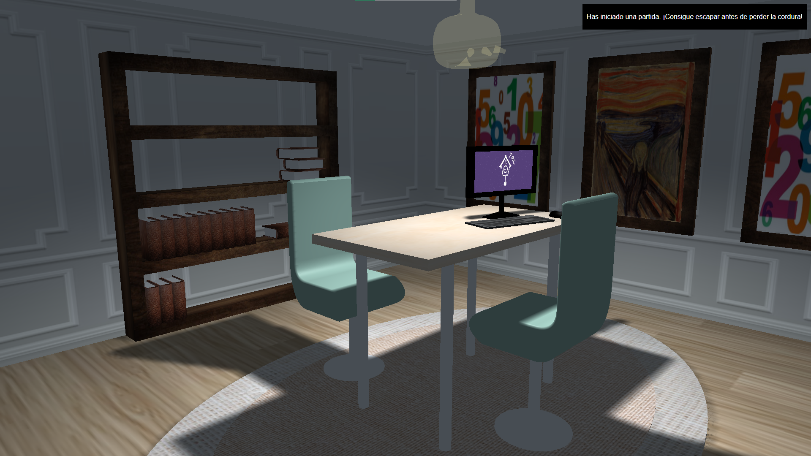

# 🏚️ La Casa de los Secretos

<p align="center">
  
  
  
</p>

<p align="center">
  <em>Un escape room en 3D, en tu navegador, donde cada sombra guarda un misterio.</em>
</p>

<div align="center">
  
</div>

---

## ✨ ¿Qué es?

**La Casa de los Secretos** es un escape room en primera persona hecho con **JavaScript** y **three.js**. Estás encerrado en una habitación y tienes que resolver **3 pistas** encadenadas para salir.

Los mensajes de la esquina superior derecha te irán guiando.

---

## 🌐 Jugar online

<p align="center">
  <a href="https://denissvalentin.github.io/EscapeRoom_LaCasaDeLosSecretos/"><b>▶ Jugar ahora en el navegador</b></a>
</p>

No hace falta descargar nada. Se necesita teclado y ratón, así que juega desde un ordenador.

---

## 🚀 Jugar en tu ordenador (3 pasos)

¿Prefieres jugar sin conexión o tocar el código? Descárgalo y lánzalo en local.

> **Solo necesitas:** un navegador moderno (Chrome, Firefox, Edge o Safari) y **cualquier** servidor web local. El juego no tiene dependencias ni paso de compilación: vale lo que ya tengas instalado.

### 1. Descarga el juego

**Con Git:**

```bash
git clone https://github.com/DenisSValentin/EscapeRoom_LaCasaDeLosSecretos.git
```

```bash
cd EscapeRoom_LaCasaDeLosSecretos
```

**Sin Git:** pulsa el botón verde **Code → Download ZIP** en GitHub, descomprímelo y abre una terminal dentro de la carpeta.

> ℹ️ La descarga ocupa unos 70 MB (texturas, vídeos y modelos 3D).

### 2. Levanta un servidor local

Elige **la que te resulte más cómoda**. Todas hacen lo mismo: servir la carpeta del proyecto en `http://localhost`.

**Sin usar la terminal**

| Herramienta | Cómo |
|---|---|
| **VS Code** + [Live Server](https://marketplace.visualstudio.com/items?itemName=ritwickdey.LiveServer) | Abre la carpeta en VS Code → clic derecho en `index.html` → **Open with Live Server**. Se abre el navegador solo. |
| [**Servez**](https://greggman.github.io/servez/) (app de escritorio) | Instálala, elige la carpeta del proyecto y pulsa **Start**. |

**Con la terminal** (desde dentro de la carpeta del proyecto)

| Si tienes… | Comando |
|---|---|
| Node.js | `npx serve -l 8000` |
| Node.js (alternativa) | `npx http-server -p 8000` |
| Python 3 (macOS / Linux) | `python3 -m http.server 8000` |
| Python 3 (Windows) | `py -m http.server 8000` |
| PHP | `php -S localhost:8000` |

¿No sabes qué tienes instalado? Prueba `node --version`, `python3 --version` (o `py --version` en Windows) o `php --version`. Si no tienes ninguno, lo más sencillo es **VS Code + Live Server** o **Servez**.

### 3. Abre el navegador

Ve a **<http://localhost:8000>**. Verás la portada del expediente: pulsa **Abrir el caso** para empezar a jugar. (Con Live Server la dirección suele ser `http://127.0.0.1:5500`; se abre sola.)

Para cerrar el servidor, vuelve a la terminal y pulsa `Ctrl + C`.

---

## ⌨️ Controles

| Tecla | Acción |
|-------|--------|
| `W` `A` `S` `D` / `Flechas` | Moverse |
| `Shift` | Activar / desactivar el control de la cámara con el ratón |
| `Ratón` | Mirar alrededor (con la cámara activada) |
| `Clic izquierdo` | Interactuar con objetos (con el cursor libre) |
| `Ctrl` | Agacharse / levantarse |

**Consejo:** pulsa `Shift` para moverte y mirar; vuelve a pulsar `Shift` para liberar el cursor y hacer clic en los objetos.

---

## 🛟 Problemas frecuentes

<details>
<summary><b>He abierto <code>index.html</code> con doble clic y sale la pantalla en blanco</b></summary>

Es normal: el juego usa módulos de JavaScript y carga texturas, y los navegadores bloquean eso cuando se abre un archivo directamente (`file://`). Tienes que usar un servidor local (paso 2).
</details>

<details>
<summary><b>La terminal dice <code>command not found</code></b></summary>

Ese programa no está instalado. Usa otra fila de la tabla (por ejemplo, en **Windows** prueba `py` en lugar de `python3`) o una de las opciones sin terminal: **VS Code + Live Server** o **Servez**.
</details>

<details>
<summary><b>"Address already in use" / el puerto 8000 está ocupado</b></summary>

Cambia `8000` por otro número en el comando (por ejemplo `8080`) y abre <http://localhost:8080>.
</details>

<details>
<summary><b>Faltan texturas o el juego se ve raro</b></summary>

- Asegúrate de lanzar el servidor **desde la carpeta del proyecto** (donde está `index.html`).
- Recarga sin caché: `Ctrl + Shift + R` (Windows/Linux) o `Cmd + Shift + R` (macOS).
</details>

---

## 🧩 Solución del juego

<details>
<summary><b>⚠️ SPOILER — haz clic solo si te has quedado atascado</b></summary>

1. **Busca la nota.** Estantería → 2ª balda → libro tumbado. Dentro hay una nota con las combinaciones `ACE, ABDF, ABDCEF, ACDBF, BACDFE`.
2. **Descifra el código.** En la pared hay tres interruptores: enciende el de arriba. Se proyectan las letras `A–F` sobre un cuadro; cada combinación dibuja un número:
   `ACE → 1` · `ABDF → 7` · `ABDCEF → 2` · `ACDBF → 4` · `BACDFE → 5` → **código `17245`**.
3. **Abre la caja fuerte.** Introduce `17245` en la caja de botones, coge el pendrive y haz clic en el ordenador. La pantalla mostrará *THE END*.
4. **Escapa.** Haz clic en el pomo de la puerta. ¡Eres libre!

</details>

---

## 🛠️ Características técnicas

| Característica | Descripción |
|----------------|-------------|
| **Colisiones** | Bounding boxes para que el jugador no atraviese paredes ni objetos |
| **Animaciones** | Apertura de cajas, pulsación de botones, movimiento de notas (Tween.js) |
| **Picking (raycasting)** | Detección de objetos al hacer clic |
| **Iluminación** | Luz ambiental, spotlights dinámicos y una luz parpadeante |
| **Sombras** | Proyección y recepción de sombras en tiempo real |
| **Texturas** | Relieve (bump / normal maps) y vídeos como textura |
| **Modelado CSG** | Geometría constructiva de sólidos para estanterías y libros |
| **Modelos jerárquicos** | Animación de la calavera sobre la tapa de la caja |
| **Modelos externos** | Calavera y pendrive cargados en formato OBJ/MTL |

### Estructura del proyecto

```
├── index.html            # Portada: jugar, controles, documentación y créditos
├── juego.html            # El juego
├── src/                  # Código del juego (una clase por objeto)
│   └── MyScene.js        # Escena principal: cámara, luces, controles, picking y bucle
├── libs/                 # three.js y librerías auxiliares (sin dependencias externas)
├── imgs/                 # Texturas y vídeos
├── models/               # Modelos 3D (OBJ/MTL)
└── documentacion_extra/  # Memoria en PDF y diagramas
```

### Ciclo de juego

1. **Init** → carga modelos, texturas y luces
2. **Update** → procesa la entrada y actualiza posiciones y animaciones
3. **Render** → dibuja la escena
4. **Repeat** → `requestAnimationFrame`

---

## 📚 Documentación

- 📄 [Memoria completa del proyecto (PDF)](documentacion_extra/Documentacion_LaCasaDeLosSecretos.pdf)

<details>
<summary><b>Diagrama de clases</b></summary>
<div align="center">
  
</div>
</details>

<details>
<summary><b>Modelo jerárquico</b></summary>
<div align="center">
  
</div>
</details>

---

## 👥 Autores

| Desarrollador | GitHub |
|---------------|--------|
| Denis Stoyanov | [@denissvalentin](https://github.com/denissvalentin) |
| Alba Guisado | [@albaguisadof](https://github.com/albaguisadof) |

---

## 📜 Licencia

Este proyecto está bajo la licencia **GPL-3.0**. Consulta [LICENSE](LICENSE) para más detalles.

<div align="center">


*¿Podrás escapar de la casa de los secretos?* 🗝️

</div>
